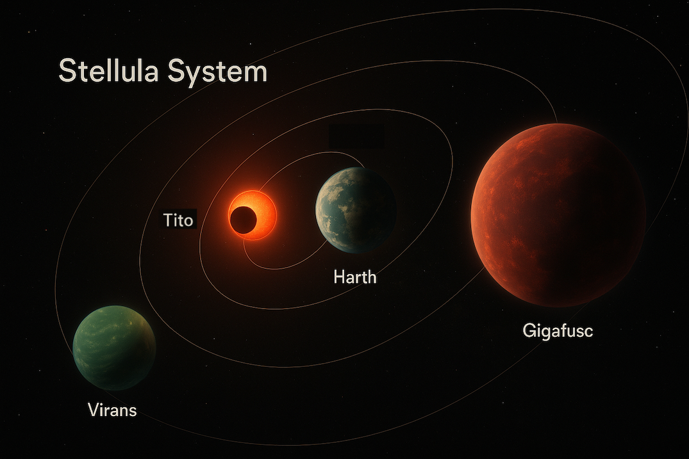

# Stellula System

*Stellula, its three planets, and the brown dwarf Gigafusc*

## System properties

| Property | Value |
| --- | --- |
| Age | ~2 Gyr |
| System mass | ~0.0934 M☉ (star, brown dwarf, and three planets, excluding moons) |
| Outermost semi-major axis | 0.1000 AU (Stellula–Gigafusc relative orbit) |
| Outermost companion | Gigafusc |
| Protoplanetary disc | Dissipated |
| Kuiper cliff | None |
| Stars | 1 (Stellula) |
| Planets | 3 (Tito, Harth, Virans) |
| Dwarf planets | 0 |
| Satellites | around Gigafusc and Virans |
| Comets | None detected |
| Inclination | Major stellar and planetary orbits nearly coplanar (<1° deviation) |
| Orbital speeds | ~87.9 km/s (Tito) to ~28.8 km/s (Gigafusc relative to Stellula) |
| Orbital periods | 1.1366–37.80 days |
| Spectral type | M9.5 |
| Variable | No |
| Frost line | ~0.0325 AU |
| Stellar binary stability screen | ~0.041 AU around Stellula for circular, coplanar test-particle orbits |

The **Stellula System** is a tightly packed, low-mass planetary system centered around a faint M9.5 red dwarf star of approximately 0.08 solar masses. The three planets orbit within 0.0330 AU of the star. Gigafusc’s relative orbit extends to 0.1000 AU, and some of its satellites can lie farther from Stellula. The system is notable for extreme angular sizes, rapid orbital periods, and complex eclipse interactions, including a super-Earth that regularly eclipses the habitable planet.

## Star

Main article: [[Stellula]]

Stellula is a hydrogen-burning red dwarf at the bottom of the main sequence, with a mass of 0.08 M☉ and radius of 0.10 R☉. Its effective temperature is estimated at ~2000 K, and its total luminosity is ~0.000145 L☉, peaking in the near-infrared. Stellula's size is only slightly smaller than its own brown dwarf companion, Gigafusc.

## Planets

**Major orbits of the Stellula System**

| Name | Orbit (AU) | Period (days) | Mass (M🜨) | Radius (R🜨) | Type | Notes |
| --- | --- | --- | --- | --- | --- | --- |
| [[Tito]] | 0.009184 | 1.1366 | 10.2 | 2.8 | Water-rich super-Earth | Tidally locked; casts total eclipses on Harth; near a 3:2 ratio of mean motions |
| [[Harth]] | 0.012034 | 1.7048 | 1 | 1 | Earth analog | Tidally locked; habitable zone center; receives ~1 F🜨 |
| [[Virans]] | 0.0330 | 7.7414 | 13 | 3.84 | Mini-Neptune | Methane-rich, green; tidally locked; past frost line |
| [[Gigafusc]] | 0.1000 | 37.80 | ~4,450 (14 M♃) | 12.3 (1.1 R♃) | Warm T-type brown dwarf | ~700 K, optically dark, internally heated; physically larger than the star |

Tito completes about three orbits for every two of Harth. Their near-3:2 ratio is part of the adopted architecture. The total mass of the star, planets, and brown dwarf is about 0.0934 M☉. Virans lies just beyond the adopted frost line of 0.0325 AU.

## Eclipses and conjunctions

The nearly coplanar major orbits favor eclipses, especially for the inner pair. Some moons of Gigafusc follow highly inclined or retrograde paths.

### Tito–Harth eclipse cycle

Tito and Harth are synchronous rotators at 0.009184 and 0.012034 AU. Inferior conjunctions of Tito as seen from Harth recur about every 3.4102 days. Eclipse depth and duration vary with observer location and alignment.

In a central, circular, coplanar model, Stellula subtends ~4.43° and Tito subtends ~4.79° at closest approach (Tito's disc exceeds Stellula's only if its radius is at least 2.6 R⊕ at this spacing). The eclipse lasts about 39 minutes between first and last contact, including about 1½ minutes of totality. These estimates use the apparent motion of Tito across Harth’s sky, accounting for the short distance between the planets. The eclipse occupies less than 1% of a synodic cycle even if the entire contact interval is counted. Tito's umbra (474,000 km long) just reaches Harth and is ~3,600 km wide there, a totality track that sweeps the surface in about 1.6 minutes, while the penumbra (~45,000 km radius) covers all of Harth for the 39 minutes. It can provide a strong local change in light without greatly reducing mean dayside irradiation.

During central totality, Tito’s dark hemisphere faces Harth. Its artificial lights can be sought with reduced direct stellar glare.

### Gigafusc alignments

Gigafusc’s 0.1000 AU relative orbit has a Keplerian period of ~37.80 days using the masses of both Stellula and Gigafusc. The Harth–Gigafusc synodic period is ~1.785 days. At favorable alignments, observers on Harth can see Gigafusc near the stellar limb or watch it pass behind the star.

At superior conjunction, behind Stellula, Gigafusc is about 0.54° across. The ~4.43° stellar disc covers it completely at a central occultation. On the near side of its orbit, around opposition from Harth, Gigafusc reaches ~0.68° across. Tito can eclipse Stellula while Gigafusc is near its limb or behind it, producing overlapping events with the appropriate orbital phases.

### Shadows on Gigafusc's moons

Tito’s full umbra extends about 474,000 km behind it. Gigafusc lies about 13.6 million km beyond Tito when both are aligned on the same side of Stellula. Its moons can see partial and annular eclipses of Stellula by Tito. At Gigafusc’s nominal distance, central coverage is about 8% by apparent disc area. Actual dimming depends on the moon’s position and stellar limb darkening.

### Global dynamical stability

An initial screening treats Stellula and Gigafusc as a circular binary separated by 0.1000 AU. The Holman–Wiegert test-particle fit gives an approximate circumstellar limit of 0.041 AU around Stellula and 0.0138 AU (~2.07 million km) around Gigafusc. The three planets and Gigafusc’s two major moons lie inside their respective screening limits. The outer irregular cluster includes orbits outside the circular coplanar prograde estimate. Their inclinations, eccentricities, and directions of motion matter. [Holman & Wiegert](https://arxiv.org/abs/astro-ph/9809315)

Virans has a nominal Hill radius near 270,000 km, placing Thalure and Obrum close to the approximate outer prograde region.

**N-body screen.** A fourth-order symplectic integration of Stellula, Tito, Harth, Virans and Gigafusc, with circular, coplanar starts at the adopted orbits, is stable for 10⁵ years in every run (seeds 1 and 2; Harth moved to a 1.6 period ratio; Virans moved to 0.030 AU). Osculating eccentricities relative to the star reach 0.035–0.068 for Tito, 0.08–0.12 for Harth (0.017 at a 1.6 ratio), about 0.07 for Virans (0.05 at 0.030 AU) and 0.009 for Gigafusc. The Tito–Harth near-3:2 pair has a mutual Hill spacing of 5.2 (stable). The integration omits moons and is a screen, not a proof, of long-term stability.

**Tidal heating.** The forced eccentricities imply very large tidal heating for Harth and Tito at ordinary rocky-planet dissipation; Harth's Earth-like interior is an adopted premise (see [[Harth]]).

## Planet and companion profiles

### Tito

Main article: [[Tito]]

Tito is a synchronous, water-rich 10.2 M🜨 super-Earth of radius 2.8 R🜨 (density 2.56 g/cm³) with a global ocean and a thick nightside ice sheet. At 0.009184 AU it receives ~1.719 Earth flux. Its equilibrium estimate is ~286 K at Bond albedo 0.35 with uniform redistribution. The 320 K global surface mean includes atmospheric warming. Human settlements on the nightside ice sheet use conditioned air and a network of illuminated infrastructure.

### Harth

Main article: [[Harth]]

Harth is an Earth-sized synchronous terrestrial planet at 0.012034 AU, receiving ~1.001 Earth flux. The reference equilibrium temperature is ~255 K at Bond albedo 0.30 with uniform redistribution. The adopted global surface mean is ~288 K. Only 2.4% of Earth's visible light reaches Harth (about 36% of its near-infrared), so its biosphere is built on far-red photosynthesis. The current reference epoch is 10,000 years after the corporate survey and biological dumping. The hybrid biosphere is established at this epoch. Harthian cultures observing Tito belong to a later era.

### Virans

Main article: [[Virans]]

Virans is a methane-rich mini-Neptune of 13 M🜨 at 0.0330 AU. It receives 0.1331 Earth flux, giving a reference equilibrium temperature of ~145 K at Bond albedo 0.45 with uniform redistribution. Its five moons include three in the adopted 1:2:4 period chain. Their recurring configurations provide a basis for calendars.

### Gigafusc

Main article: [[Gigafusc]]

Gigafusc is an optically dark, internally heated brown dwarf of 14 M♃ at 0.1000 AU. It has a ~37.80-day relative orbital period and a photosphere at ~700 K. Its rings and aurorae frame two major moons in a 2:1 resonance, the volcanic Scauron and ocean-bearing Lumora. At the reference epoch, probes and flybys have visited its satellite system.

## Physical basis

**Eclipse geometry.** Stellula subtends 4.43° from Harth and 5.80° from Tito, and Tito subtends 4.79° from Harth at their 426,360 km conjunction separation. Tito's umbra is 474,000 km long, so Harth lies inside it near the tip (umbral radius about 1,800 km, track about 3,600 km), and the penumbra has a radius of about 45,000 km. A shadow speed of about 38 km/s relative to Harth gives about 94 s of totality and about 39 min between first and last contact. Totality needs Tito's radius to be at least 2.6 R⊕ at this spacing and the mutual inclination to be below about 1.1°. It also needs a Tito–Harth period ratio below about 1.55, so the 3:2 near-resonance (ratio 1.49991, mutual Hill spacing 5.2) cannot be detuned without losing the total eclipse. Twenty-nine Tito–Harth–Virans conjunction cycles of about 40.95 d match 12 Tito–Harth eclipses of about 40.92 d.

**N-body screen.** The screen uses a purpose-written fourth-order symplectic (Yoshida) integrator with a step of 0.02 d, circular and coplanar starts, and planets only. Every run is stable: thirteen 2,000-year configurations (including controls without Gigafusc and without Tito, and Tito–Harth ratios 1.45–1.70) and 10⁵-year runs of the adopted orbits (two seeds), of a ratio of 1.6, and of Virans at 0.030 AU. Maximum osculating eccentricity over 10⁵ years, relative to the star:

| Body | Adopted orbits | Tito–Harth ratio 1.6 |
| --- | --- | --- |
| Tito | 0.030–0.068 | 0.010 |
| Harth | 0.080–0.115 | 0.017 |
| Virans | 0.047–0.070 | — |
| Gigafusc | 0.007–0.009 | — |

Moons are not integrated.

**Adopted premises.** Working choices preserve the stated major orbital distances, the stellar radius and luminosity, and the detailed planetary masses. Adopted or flagged assumptions, rather than derived results, are Harth's low tidal dissipation, the quiet-star X-ray level (about 10⁻⁶ of Stellula's luminosity), Tito's water fraction and moist-greenhouse albedo, and Gigafusc's ~700 K photosphere (an evolutionary estimate for 14 M♃ at 2 Gyr). Tidal heating uses assumed k₂/Q values (0.003 rocky, 0.015 Scauron, 0.01 Lumora) with the synchronous-rotator formula, which is uncertain by about a factor of 10; photon fluxes are blackbody estimates; and Gigafusc's temperature, Tito's water fraction and the moist-greenhouse threshold come from published models cited from memory and not recomputed. Exact resonance states and the outer moons' long-term trajectories remain open.
